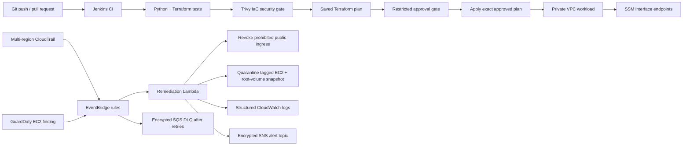

# AWS Cloud Security Guardrails with Jenkins CI/CD

A portfolio lab that demonstrates two complementary security layers:

1. **Shift-left prevention:** Jenkins validates and tests Terraform and Python, runs a fail-closed Trivy configuration scan, creates a saved Terraform plan, and requires approval before applying that exact plan.
2. **Runtime response:** CloudTrail write events flow through EventBridge to a Python Lambda that removes prohibited public security-group ingress. High-severity GuardDuty EC2 findings can invoke the same Lambda to isolate a tagged instance and snapshot its root EBS volume.

> This is a security-engineering lab, not a compliance certification or a production reference architecture. Live AWS behavior and latency must be measured in a sandbox account before making performance claims.

## Architecture



## What is implemented

### Jenkins pipeline

- Explicit SCM checkout and toolchain verification.
- Terraform formatting, initialization, validation, and mocked infrastructure tests.
- Python compilation, seven unit tests, and a local handler smoke test.
- Fail-closed Trivy scanning for `HIGH` and `CRITICAL` Terraform findings.
- A deliberately insecure Terraform fixture that proves the scanner detects public SSH.
- Deployment stages restricted to protected `main` branch builds, not pull requests.
- AWS account identity check before plan and apply.
- Remote S3 backend configuration supplied through a Jenkins secret-file credential.
- Saved-plan checksum, human approval, and application of the exact approved plan.
- Post-deployment convergence, Lambda invocation, and EventBridge target checks.

### AWS controls

- Private EC2 workload with no inbound rule and no public IP.
- IMDSv2 required and root EBS volume encrypted with a customer-managed KMS key.
- SSM, SSMMessages, EC2Messages, and CloudWatch Logs interface endpoints.
- Multi-region CloudTrail write-management-event trail with validation and KMS encryption.
- EventBridge retry policy and encrypted SQS dead-letter queue.
- Structured JSON Lambda audit records and CloudWatch alarms for Lambda/DLQ failures.
- Runtime changes limited to resources tagged `ManagedBy=CloudSecurityGuardrails`.
- Public IPv4 and IPv6 detection, all-protocol rules, and port ranges that include prohibited ports.
- GuardDuty EC2 event parsing using the documented EventBridge finding structure.

## Repository layout

```text
.
├── Jenkinsfile
├── ci/
│   └── backend-prod.hcl.example
├── scripts/
│   ├── test_security_gate.sh
│   └── verify_deployment.sh
├── src/
│   └── lambda_remediation.py
├── terraform/
│   ├── backend.tf
│   ├── detection.tf
│   ├── main.tf
│   ├── outputs.tf
│   ├── variables.tf
│   └── tests/security.tftest.hcl
├── tests/
│   ├── fixtures/insecure/main.tf
│   ├── simulate_drift.py
│   └── test_remediation.py
├── .gitignore
├── .trivyignore
└── requirements.txt
```

## Local verification

Prerequisites: Terraform 1.10+, Python 3.9+, Trivy, and `jq`.

```bash
# Python behavior
python3 -m unittest discover -s tests -p 'test_*.py' -v
python3 tests/simulate_drift.py --mode dry-run

# Terraform syntax and mocked infrastructure assertions
terraform -chdir=terraform init -backend=false
terraform -chdir=terraform validate
terraform -chdir=terraform test

# Shift-left security controls
trivy config --quiet --severity HIGH,CRITICAL --exit-code 1 terraform
scripts/test_security_gate.sh
```

The dry-run calls the Lambda handler with mocked AWS clients. It verifies decision logic but **does not measure CloudTrail → EventBridge → Lambda latency**.

## Jenkins setup

Use a multibranch Pipeline job with a protected `main` branch. The Jenkins agent label `terraform-aws` must provide:

- Terraform 1.10+
- Python 3.11 or 3.12
- Trivy pinned in the agent image
- AWS CLI v2
- `jq`, `shasum`, and Git

Create these Jenkins credentials:

| Credential ID | Type | Purpose |
|---|---|---|
| `aws-devsecops-creds` | AWS credentials or compatible role binding | Terraform and post-deploy AWS calls |
| `aws-prod-account-id` | Secret text | Prevent deployment to the wrong AWS account |
| `terraform-backend-config` | Secret file | Environment-specific S3 backend settings |

Restrict approval to the Jenkins group `cloud-platform-approvers`, or change the `submitter` value in `Jenkinsfile` to your authorized group.

For stronger isolation, use short-lived credentials from an instance role, EKS IRSA, or OIDC federation rather than long-lived access keys. Untrusted pull-request jobs must never receive deployment credentials.

## Remote Terraform state

The deployed stack does not create its own backend. Bootstrap a separate, versioned, encrypted S3 state bucket first. Copy `ci/backend-prod.hcl.example`, fill in the real bucket and account ID, then store the file in Jenkins as `terraform-backend-config`.

Do not commit the real backend file, state, saved plans, or AWS credentials.

## Deployment notes

This stack creates billable AWS resources, including EC2, interface VPC endpoints, CloudTrail/S3, KMS keys, Lambda, SNS, SQS, and CloudWatch. Deploy it only in an authorized sandbox account and destroy it when the demonstration is complete.

An SNS topic is created as an alerting extension point, but no email, PagerDuty, or ServiceNow subscription is configured by default. GuardDuty must already be enabled in the account for GuardDuty findings to exist.

## Verified locally

- Python unit tests: **7 passed**.
- Mocked Terraform infrastructure test: **1 passed**.
- Terraform formatting and validation: **passed**.
- Trivy `HIGH,CRITICAL` scan of the project Terraform: **0 findings**.
- Negative security fixture: **1 blocking public-SSH finding detected**.
- Local drift simulation: **passed with mocked AWS clients**.

A live AWS deployment and end-to-end remediation latency test are intentionally not claimed here.

## Portfolio talking points

- Built a Jenkins pipeline that validates Terraform, tests Python remediation logic, blocks high-severity IaC findings, and applies an approval-controlled saved plan.
- Implemented tag-scoped EventBridge and Lambda automation that removes prohibited public security-group ingress and routes failed events to an encrypted dead-letter queue.
- Hardened a private EC2 lab with IMDSv2, KMS-encrypted EBS, SSM interface endpoints, CloudTrail audit logging, and CloudWatch operational alarms.

## Author

**Trey Wright**  
[LinkedIn](https://www.linkedin.com/in/trey-wright-30743530/) · [GitHub](https://github.com/TreyWright360)
